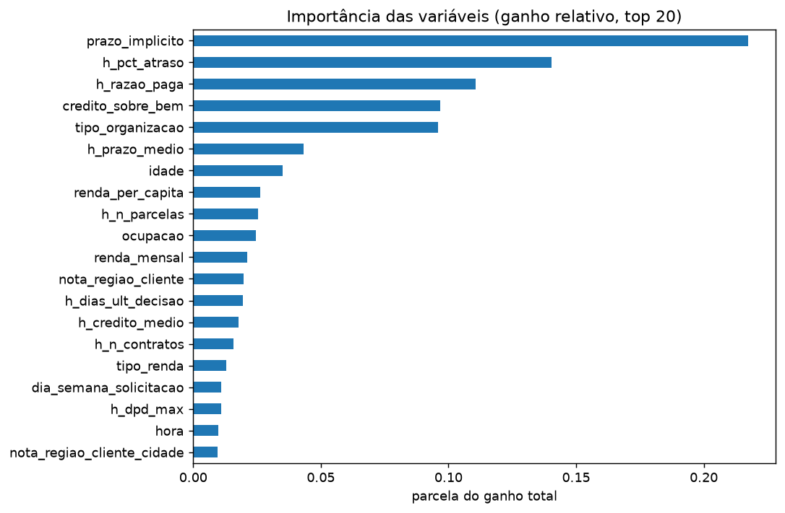

# Modelo de inadimplência e política de crédito — Case DS Accelerator (WeCogno)

Modelo que estima a probabilidade de um contrato de crédito pessoa física ter atraso de 30 dias ou mais, e uma política de crédito por faixas de risco (aprovar, aprovar com ajuste, rejeitar). As previsões cobrem os 50.000 clientes de `base_submissao`.

Relatório do que foi feito e onde: [REPORT.md](REPORT.md).

## Resultados

**Target (inadimplência):** atraso de 30 dias ou mais em alguma das 12 primeiras parcelas, em contratos aprovados e já maduros. A base de modelagem tem 104.029 contratos, com 14,1% de inadimplência.

**Validação fora do tempo** (treino: decisões até 2022-06 com 60.520 contratos; validação: 2022-07 a 2023-03 com 17.780; teste: 2023-04 em diante com 25.729):

| Modelo | AUC (IC 95%) | Gini | KS |
|---|---|---|---|
| Regressão logística (base de comparação) | 0,689 (0,681–0,698) | 0,377 | 0,278 |
| **LightGBM (modelo final)** | **0,727 (0,719–0,737)** | **0,454** | **0,338** |

Outras leituras do LightGBM no teste:

| Recorte | AUC |
|---|---|
| Contratos de clientes com histórico (96% da submissão) | 0,733 |
| Contratos de clientes que o modelo não viu no treino (7.955) | 0,618 |
| Sem as variáveis de histórico | 0,634 |
| Sem sexo e idade | 0,728 |

- **O histórico de pagamento do cliente é o que mais pesa.** Sem ele o AUC cai de 0,727 para 0,634.
- **Sexo e idade não acrescentam poder preditivo** (AUC 0,728 sem eles, contra 0,727 com eles). Eles continuam no modelo por decisão do projeto. O uso de sexo em crédito tem risco regulatório (LGPD e normas de não discriminação).
- **Calibração:** a taxa real por decil acompanha a probabilidade prevista, com leve subestimação nos decis 4 a 8 (veja `outputs/figures/calibration.png`). Brier 0,097.
- **Clientes novos:** a queda para 0,618 mistura "o modelo não conhece o cliente" com "o cliente não tem histórico". Os dois efeitos não se separam com estes dados.

### Política de crédito

Cortes sobre a probabilidade, escolhidos na validação e conferidos no teste:

| Faixa | Probabilidade | Ação | Teste: % da carteira | Teste: inadimplência | Validação: inadimplência |
|---|---|---|---|---|---|
| Baixo risco | menor que 0,10 | aprovar | 64,1% | 6,7% | 5,4% |
| Médio risco | de 0,10 a 0,25 | aprovar com ajuste | 27,1% | 16,1% | 11,9% |
| Alto risco | 0,25 ou mais | rejeitar | 8,8% | 40,9% | 42,6% |

A taxa média do teste é 12,3%. Nas submissões:

| Faixa | % dos 50.000 clientes |
|---|---|
| aprovar | 66,4% |
| aprovar com ajuste | 14,7% |
| rejeitar | 18,9% |

As ações de "aprovar com ajuste" (reduzir valor, encurtar prazo, exigir entrada) são sugestões e não foram validadas com dados.

### Importância das variáveis



A tabela completa está em `outputs/feature_importance.csv`. O gráfico SHAP (`outputs/figures/shap_summary.png`) mostra o sentido do efeito de cada variável.

## Atenção: a submissão não se parece com o treino

1. **Valores dos contratos em outra escala.** O crédito mediano da submissão é 450.000. Nos contratos aprovados de 2023 em diante é cerca de 132.000. O crédito dividido pela parcela é 20 na submissão e 10,8 no treino. Testei quatro conjuntos de variáveis:

   | Conjunto | AUC teste | AUC com histórico | % rejeitar na submissão |
   |---|---|---|---|
   | Completo | 0,7255 | 0,7323 | 17,2% |
   | Sem valores absolutos (crédito, bem, parcela) | 0,7272 | 0,7340 | 17,6% |
   | Sem valores absolutos e sem razões com a renda | 0,7263 | 0,7325 | 18,6% |
   | Mesmo conjunto, sem `prazo_implicito` e `credito_sobre_bem` | 0,7241 | 0,7263 | 16,6% |

   Os valores absolutos não ajudam o modelo, então foram removidos junto com as razões com a renda (terceira linha). O modelo final usa esse conjunto. Ainda restam `prazo_implicito` e `credito_sobre_bem`, que têm distribuição diferente na submissão. Elas carregam sinal e ficaram. **Confirme com o banco se a submissão usa a mesma unidade do histórico.**
2. **A submissão rejeita mais.** São 18,9% contra 8,8% no teste. Esse desvio persiste mesmo sem as variáveis de valor, então vem de outra parte, provavelmente do histórico de pagamento (96% da submissão tem histórico, contra 61% do treino). O PSI do score entre teste e submissão é 0,185, desvio moderado. Revise os cortes com o banco antes de usar.
3. **Modelo final retreinado com todos os dados.** Na submissão, o score médio do modelo validado é 0,146 e o do modelo final é 0,139. A correlação é 0,97 e o PSI é 0,015.

## Como reproduzir

Requisitos: Python 3.12. Os arquivos do case estão em `dados/` (versionados no git, 36 MB):
`base_cadastral.parquet`, `base_submissao.parquet`, `historico_emprestimos.parquet`, `historico_parcelas.parquet`.

```
python -m venv venv
venv\Scripts\activate
pip install -r requirements.txt

python -m src.build_dataset   # monta target e variáveis -> data/interim/
python -m src.train           # treina e salva models/lgbm.joblib (imprime as métricas do teste)
python -m src.predict         # gera submissao/submission_predictions.csv
python -m pytest tests        # 6 testes

jupyter nbconvert --to notebook --execute --inplace notebooks/0*.ipynb
```

Para rodar tudo na ordem certa (dataset, modelo, previsões, testes e os 7 notebooks): `python run.py` (`--sem-notebooks` pula os notebooks).

Os notebooks 05, 06 e 07 leem o modelo e o CSV de previsões, então rode os três comandos `src` antes. O notebook 05 grava os gráficos em `outputs/figures/`.

### Estrutura

```
dados/                      dados do case (somente leitura)
data/interim/               train.parquet, submission.parquet (gerados)
src/
  config.py                 caminhos, semente, janela e limite do target
  data_loader.py            leitura, datas, texto sem acento, duplicatas
  target.py                 parcelas da janela e definição de inadimplência
  features.py               variáveis do contrato, do cadastro e do histórico
  build_dataset.py          monta as matrizes de treino e submissão
  train.py                  divisão no tempo, LightGBM, métricas, modelo final
  evaluate.py               AUC, KS, Gini, Brier, decis, PSI
  policy.py                 cortes e resumo por faixa
  predict.py                pontua a submissão e aplica a política
  segmentation.py           faixas de score A-E por inadimplência
notebooks/                  01 qualidade dos dados · 02 target · 03 variáveis · 04 modelagem
                            05 avaliação e explicabilidade · 06 política de crédito · 07 faixas de score
tests/                      testes do target, do histórico, das datas e dos acentos
models/                     lgbm.joblib (gerado)
outputs/                    gráficos e feature_importance.csv
submissao/                  submission_predictions.csv
.claude/                    contexto, plano original e log de decisões (DECISIONS.md)
```

## Como o modelo é montado

- **Cliente com histórico:** para cada contrato, o histórico usa só contratos decididos e pagamentos feitos antes do corte. O corte é `data_decisao` no treino e `data_solicitacao` na submissão. Parcela vencida e não paga até o corte conta como atraso.
- **Parcelas:** vale a versão mais recente de cada parcela. Pagamentos parciais em datas diferentes são somados. Cópias do mesmo pagamento (mesma data) contam uma vez. Parcela quitada é a que recebeu 95% ou mais do valor previsto.
- **Maturidade:** entram só contratos cuja última parcela da janela venceu há 30 dias ou mais em 2025-02-22 (última data de pagamento nos dados).
- **Atraso:** para parcela quitada, a data do último pagamento menos o vencimento. Para parcela em aberto, a data de observação menos o vencimento.

## Colunas usadas pelo modelo (34)

O modelo só usa variáveis que existem também na submissão. A coluna "Origem" diz de onde cada uma vem.

### Contrato atual

| Variável | Origem | O que é |
|---|---|---|
| `tipo_contrato` | submissão / histórico | Tipo do contrato (empréstimo em dinheiro, financiamento de consumo, crédito rotativo) |
| `dia_semana_solicitacao` | submissão / histórico | Dia da semana em que o pedido foi feito |
| `hora` | submissão / histórico | Hora do dia do pedido (0 a 23), tirada de `hora_solicitacao` |
| `credito_sobre_bem` | calculada | Valor do crédito dividido pelo valor do bem financiado |
| `prazo_implicito` | calculada | Valor do crédito dividido pela parcela: parcelas necessárias para pagar o crédito |

### Cadastro do cliente (`base_cadastral`)

| Variável | O que é |
|---|---|
| `idade` | Idade em anos na data de corte, a partir de `data_nascimento` |
| `sexo` | Sexo declarado |
| `qtd_filhos` | Quantidade de filhos |
| `qtd_membros_familia` | Quantidade de pessoas na família |
| `renda_mensal` | `renda_anual` dividida por 12 |
| `renda_per_capita` | `renda_mensal` dividida por `qtd_membros_familia` |
| `tipo_renda` | Fonte da renda (trabalho, pensão, aposentadoria etc.) |
| `ocupacao` | Ocupação profissional (31% vazia) |
| `tipo_organizacao` | Tipo de empresa onde trabalha |
| `nivel_educacao` | Escolaridade |
| `estado_civil` | Estado civil |
| `tipo_moradia` | Tipo de moradia |
| `possui_carro` | Possui carro (sim ou não) |
| `possui_imovel` | Possui imóvel (sim ou não) |
| `nota_regiao_cliente` | Nota de risco da região de residência |
| `nota_regiao_cliente_cidade` | Nota de risco da região, ajustada para a cidade |

### Histórico do cliente (contratos e parcelas anteriores ao corte)

As variáveis `h_*` ficam vazias para quem não tem contrato anterior.

| Variável | O que é |
|---|---|
| `h_n_contratos` | Quantidade de contratos já decididos |
| `h_dias_ult_decisao` | Dias entre o corte e a decisão do contrato anterior mais recente |
| `h_n_recusado` | Quantidade de contratos recusados |
| `h_pct_recusado` | Parcela dos contratos anteriores que foi recusada |
| `h_credito_medio` | Valor médio do crédito dos contratos anteriores |
| `h_prazo_medio` | Prazo médio (parcelas planejadas) dos contratos anteriores |
| `h_n_parcelas` | Quantidade de parcelas anteriores já vencidas ou pagas |
| `h_dpd_medio` | Atraso médio, em dias, nessas parcelas |
| `h_dpd_max` | Maior atraso, em dias |
| `h_pct_atraso` | Parcela das parcelas pagas com algum atraso |
| `h_pct_atraso30` | Parcela das parcelas com atraso de 30 dias ou mais |
| `h_razao_paga` | Média de valor pago dividido por valor previsto (zero para parcela ainda em aberto) |
| `tem_historico` | 1 se o cliente tem contrato anterior, 0 se não |

### Colunas dos dados originais que não entram no modelo

- Taxas de juros: 100% vazias no histórico.
- Canal de venda, finalidade, produto, categoria do bem, entrada, motivo da recusa, seguro e outras: existem só no histórico, não na submissão.
- Status final do contrato: só a recusa é usada. Aprovado e cancelado são status de hoje, não do corte (entrariam com informação do futuro).
- Valores absolutos do contrato atual (`valor_credito`, `valor_bem`, `valor_parcela`): usados só para calcular as razões, depois removidos.
- Razões com a renda (crédito e parcela sobre a renda): removidas pelo mesmo motivo de escala.

## Qualidade dos dados: o que foi tratado

| Problema | Tratamento |
|---|---|
| Cadastro com 600 e submissão com 400 `id_cliente` repetidos (cópias com números alterados, no fim do arquivo) | Mantida a primeira ocorrência; 50.000 clientes únicos |
| Datas em formatos misturados (`2025-02-24` e `24/02/2025`) | Lidas pelos dois formatos |
| 51 datas com mês 13 na submissão (`2025-13-01`) | Tratadas como dia e mês invertidos (13/01/2025) |
| 38 nascimentos impossíveis (`31/02/1990`) | Viram nulo |
| `renda_anual` como texto (`90.000,00`), com "não informado", valores negativos e extremos (até 117 milhões) | Convertida em número; texto e negativos viram nulo |
| `sexo`, tipo de contrato e dia da semana com caixa, espaços e acentos diferentes | Texto em minúsculas, sem espaços nas pontas e sem acento |
| Parcelas repetidas (79.945 linhas) | Cópias do mesmo pagamento contam uma vez; parciais em datas diferentes são somadas |
| 9.023 contratos aprovados sem data do primeiro vencimento | Data estimada pelas parcelas |
| Nomes de colunas diferentes do dicionário (`indicador_*` em vez de `flag_*`) | Usados os nomes reais dos arquivos |

## Limitações

- **Só contratos aprovados têm desempenho.** O modelo não conhece o perfil dos recusados e pode errar para quem seria recusado no passado.
- **O cadastro é um retrato de hoje**, não do dia do contrato. Renda e moradia podem ter mudado.
- **O histórico não traz a data de solicitação.** O corte usa a data da decisão.
- **O target usa uma aproximação para a maturidade** (30 dias por parcela a partir do primeiro vencimento).
- **`valor_credito` e `qtd_parcelas_planejadas` dos contratos anteriores** são valores finais de hoje e podem ter mudado depois do corte. Não medi o quanto isso pesa.
- **Escolha do limite de atraso:** 30 dias. Com 60 dias a taxa cai para 8,2% e com 90 dias para 4,4%.
- **Sem simulação financeira.** Uma extensão possível é simular a política com perda em caso de inadimplência e margem explícitas, com análise de sensibilidade.
